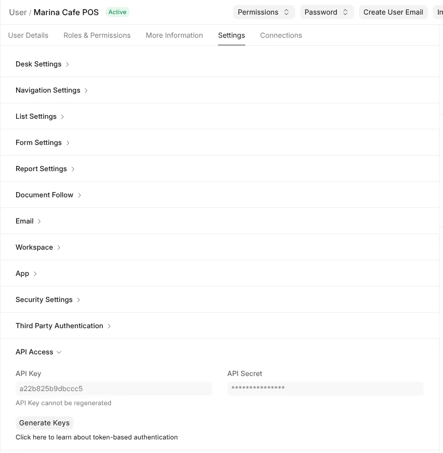
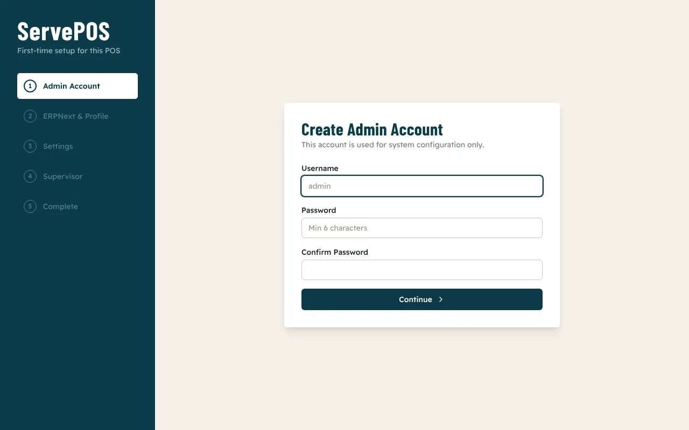
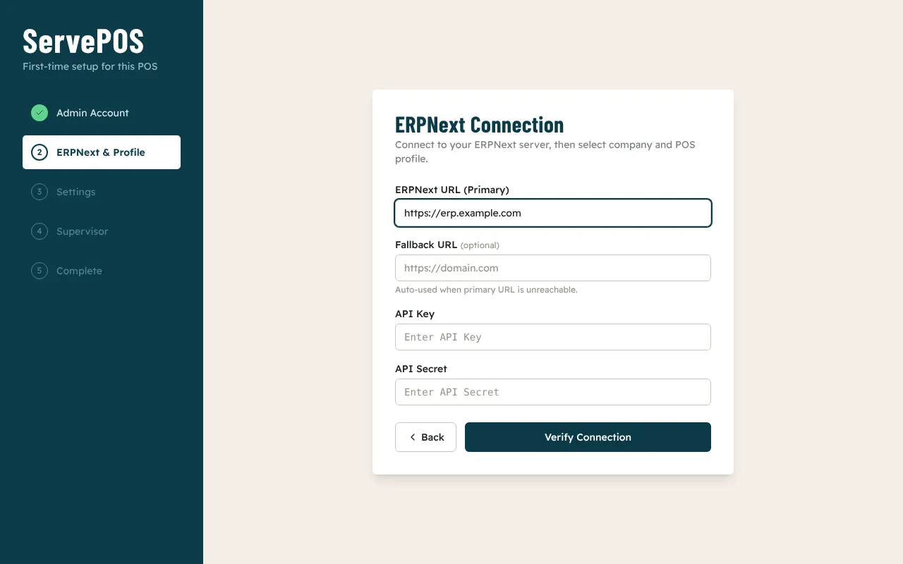
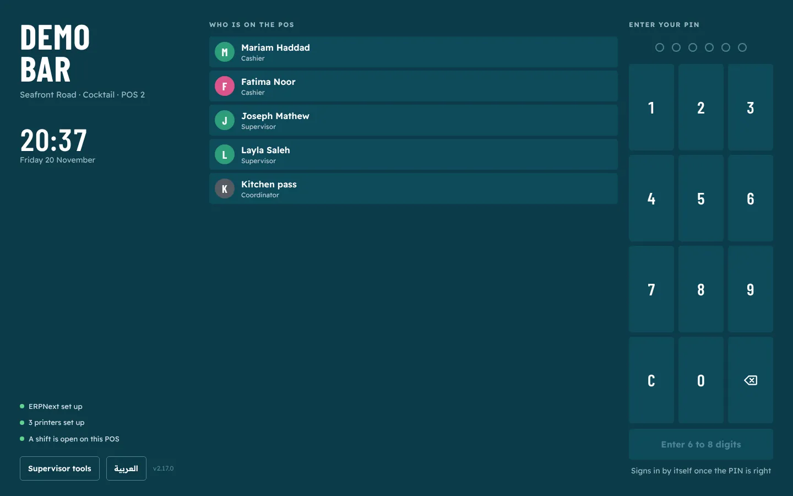
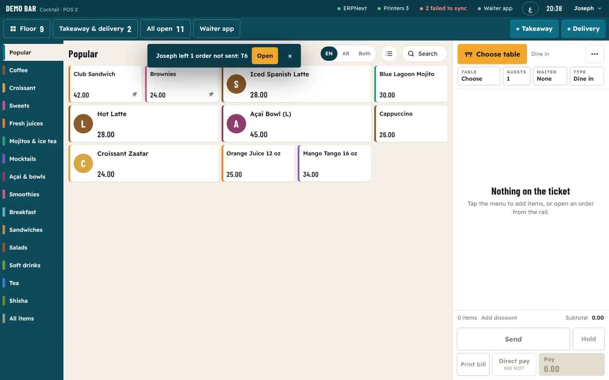

# Install and connect the desktop POS

The desktop POS runs at the counter. It keeps its own copy of the menu and saves every sale on the computer first, so it keeps selling when the internet drops. It sends the sales to ERPNext in the background.

## Before you start: do these in ERPNext first

The POS reads everything from ERPNext, so set up ERPNext **before** you install the POS. If you skip this, the POS connects but has no outlet to choose.

1. **The outlet's POS Profile.** Create it in ERPNext ([Set up an outlet](outlet-setup.md#7-create-the-pos-profile)). The POS lists only the POS Profiles that exist, so an outlet you have not created yet does not appear.
2. **A warehouse for the outlet** (recommended). Create one warehouse per outlet and choose it in the outlet's POS Profile, so each outlet's stock is counted on its own ([Add a warehouse](outlet-setup.md#3-add-a-warehouse-for-the-outlet)).
3. **The POS user and its API key.** Create a user for the outlet's POS and generate its API key, as in the next section.

Then have these ready at the counter:

- The site address, for example `https://your.site`
- The **API Key** and **API Secret**

### Get the API key from ERPNext

1. In ERPNext, open **User** and open the outlet's POS user (for example *pos.marina@yourcompany.com*). If you have not created it yet, see [The POS user and its API key](users.md#the-pos-user-and-its-api-key): it needs the roles **ServePOS Cashier** and **Accounts User**.
2. Open the **Settings** tab and scroll down to **API Access**.
3. Click **Generate Keys**.
4. Copy the **API Key** and the **API Secret**. ERPNext shows the secret only once, so keep it until it is typed into the POS.

## 1. Install it

Download the latest version from the [releases page](https://github.com/badeeltechnology/servepos-releases/releases/latest):

| Computer | File |
|---|---|
| Windows 10 or 11 | `servepos-desktop-<version>-setup.exe` |
| macOS | `servepos-desktop-<version>.dmg` |
| Linux (64-bit) | the `.AppImage` file |

Run it. On Windows, if SmartScreen warns about an unknown publisher, click **More info** › **Run anyway**.

Once installed, the POS updates itself: when a new version is out, a supervisor sees it in **Settings** › **Updates**.

## 2. First-time setup

The first time it opens, the POS walks you through five steps, in this order:

1. **Admin Account**: the super admin of this POS
2. **ERPNext & Profile**: connect with the API key, then choose the outlet
3. **Settings**: branch code and terminal number
4. **Supervisor**: the first supervisor PIN
5. **Complete**: the menu downloads

### Step 1: Admin Account

Create the POS's super admin: a **Username** and a **Password** (at least 6 characters), typed twice under **Confirm Password**.

This account opens **Supervisor tools** on the sign-in screen: the ERPNext connection, the receipt layout, supervisors and updates. It is not an ERPNext user; it exists only on this computer. Write it down somewhere safe: without it, nobody can change the connection or the receipt later.

### Step 2: Connect to ERPNext and choose the outlet

| Field | What to enter |
|---|---|
| **ERPNext URL (Primary)** | Your site address, `https://your.site` |
| **Fallback URL** | Optional: a second address for the same site (for example a local network address). The POS uses it when the first one is out of reach. |
| **API Key** | The API Key you copied from ERPNext ([above](#get-the-api-key-from-erpnext)) |
| **API Secret** | The API Secret you copied with it |

1. Click **Verify Connection**. The POS signs in to ERPNext as the POS user.
2. **Company**: pick your company.
3. **POS Profile**: the POS lists the POS Profiles in ERPNext. Pick this outlet's, for example *Marina Cafe*. The outlet name you choose here is the name the cashiers see.
4. Click **Continue**.

If **Verify Connection** shows an error:

| The POS says | What to do |
|---|---|
| *No POS Profiles found in ERPNext. Please create a POS Profile first.* | Create the outlet's POS Profile in ERPNext ([Set up an outlet](outlet-setup.md#7-create-the-pos-profile)). If it already exists, give the POS user the **Accounts User** role. Then click **Verify Connection** again. |
| *No companies found in ERPNext.* | Finish the ERPNext setup wizard ([Install](install.md#2-finish-the-erpnext-setup-wizard)) |
| *Invalid credentials* or *Failed to verify connection* | Check the address, the API Key and the API Secret ([Troubleshooting](troubleshooting.md#the-pos-cannot-connect)) |

### Step 3: Settings

| Field | What to enter |
|---|---|
| **Branch Code** | A short code for the outlet, for example *MC*. It starts every order number. |
| **Terminal No.** | *T01* for the first POS at this outlet, *T02* for the second, and so on. Each POS must have its own. |
| **Auto-sync Interval** | How often the POS checks ERPNext for menu changes and sends sales. *Every 1 minute* is a good default. |
| **Inactivity Timeout** | Signs the cashier out after this long without use |

Order numbers look like `MC-T01-0001`. The number is saved on the Sales Invoice, and the POS checks it before posting, so a sale never posts twice even if the network drops in the middle.

### Step 4: Supervisor

The first supervisor: a **Name** and a **PIN** of 6 to 8 digits. Supervisors open **Settings** on the POS, approve voids and larger discounts, and add cashiers.

### Step 5: Complete

The POS downloads the menu, payment methods, tables, modifiers and offers. You land on the sign-in screen.

## 3. Add cashiers

1. Sign in with the supervisor PIN.
2. Click your name at the top right › **Settings** › **Cashiers**.
3. Add each cashier: **Name**, **PIN**, and the **largest discount** they may give. Choose the role **Cashier**, or **Coordinator** for the kitchen pass ([Kitchen](kitchen.md)).

## 4. Set up printing

If you print receipts or kitchen tickets, do [Printers](printers.md) and [Receipt and ticket layout](print-format.md) now, before the first real sale.

## 5. Open a shift

A cashier signs in with their PIN. If no shift is open, the POS asks to **Open shift**: count the **opening float** (the cash already in the drawer) and open.

## 6. Make a sale

1. **Dine in**: click **Choose table** and pick a table on the floor plan, then the number of **Guests** and the **Waiter** if you like. For **takeaway** or **delivery**, click **+ Takeaway** or **+ Delivery** at the top right.
2. Tap items. If an item has modifiers, choose them. Tap a line on the ticket to change the quantity, add a note or remove it.
3. **Send** prints the kitchen ticket and keeps the order open. **Hold** saves it without sending.
4. **Print bill** prints the bill for the guest to check.
5. **Pay**: choose the method (cash, card...), type the amount given, and confirm. The change is shown, the receipt prints, and the cash drawer opens.

Other buttons:

- **Direct pay**: pay straight away without a kitchen ticket, for drinks or retail at the counter. A supervisor can limit who sees it ([print format](print-format.md#print-document-settings)).
- **Add discount**: a promo, a voucher code or a manual discount, within the cashier's limit.
- **Split**, on the payment screen: split the bill by item, evenly, or by guest.
- **All open** and **Floor**: every open order and table, with how long guests have been seated.
- The **ع** button switches the whole POS to Arabic, right to left. **EN**, **AR** and **Both** above the menu choose which names the item tiles show.

### Voids

Removing an item that was already sent to the kitchen, or voiding a paid order, needs a supervisor PIN and a reason. Every void is logged with who did it. If the sale was already in ERPNext, the Sales Invoice is cancelled there too. You can see voids in the manager app's [reports](reports.md).

## 7. Close the shift

Click your name › **Close shift**.

1. **Count the cash in the drawer**. Tap a note or coin's count to type how many you have, or type a total.
2. **Finished counting, compare** shows the **Expected in drawer** against the **Counted cash**.
3. If orders are still open, pay or void them, or **Close and hand over** to the next shift: tables stay open and their payments count in the next drawer.
4. **Close shift** prints the closing voucher. The shift is saved in ERPNext as a **Shift Log** for the outlet.

A supervisor can also set **Auto-close Shift At** in **Supervisor tools** › **System**, to close the shift at the same time every night.

## When the internet drops

Keep selling. The status bar at the top shows **ERPNext** in red and how many sales are waiting. Kitchen tickets and receipts still print, because the printers are on the local network. When the line is back, the POS sends the waiting sales by itself, or a supervisor clicks **Sync now** in **Settings** › **Sync**.

If a sale cannot post (for example a payment method has no account), the status bar shows **failed to sync**. **Settings** › **Sync** lists each failed sale with the reason from ERPNext. Fix the cause in ERPNext and sync again.

## Supervisor tools

On the sign-in screen, **Supervisor tools** opens the admin screens with the admin account from step 2:

- **Print Format**: the receipt and kitchen ticket layout, taxes, discounts and currency ([Receipt and ticket layout](print-format.md))
- **System**: the ERPNext connection (**Edit Connection**), sync, auto-close time, branch code and terminal number
- **Updates**: the installed version and new versions
- **Supervisor**: add supervisors and reset their PINs

**Next:** [Printers](printers.md)
