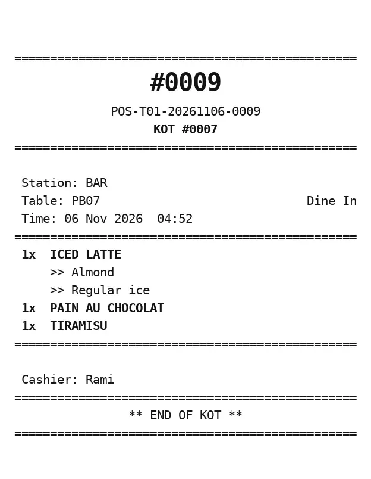
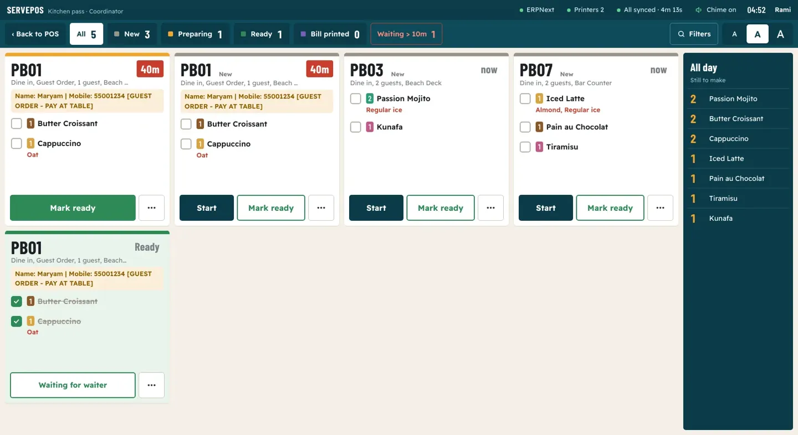

# Kitchen

Serve POS gets orders to the kitchen in two ways, and you can use either or both:

- **Kitchen tickets (KOTs)** printed in each kitchen and bar.
- **The kitchen screen** on the POS: every open ticket with its timer.

## Kitchen tickets

When the cashier clicks **Send** (or a waiter or guest order is accepted), the POS prints a KOT in each kitchen that has items in the order. Which kitchen gets which items is set with print routes by menu category: see [Printers](printers.md#send-each-kitchen-its-own-items).

Each ticket shows the order number, table, items with their modifiers and the cashier's notes. What else it shows, and the font size, is set in [Receipt and ticket layout](print-format.md#kot-options).

If an order changes after it was sent, the POS prints a change ticket so the kitchen knows what was added or taken off.

## The kitchen screen

The kitchen screen shows every ticket still to make, oldest first, with how long it has waited. Kitchen staff mark tickets as they go: **Start preparing**, then **Mark ready**. The cashier and the waiters see the status change. Tickets still being made after 30 minutes chime once, so they are not forgotten.

**All day** (or **Still to make**) adds up every open ticket by item: *7 Flat White, 3 Caesar*. The cook makes them in batches.

To open it:

- On the cashier's POS: click your name › **Kitchen view**.
- On a screen of its own in the kitchen (a second POS computer or a touch screen): give the kitchen a **Coordinator** login. A supervisor adds it in **Settings** › **Cashiers** with the role **Coordinator**. Signed in with that PIN, the POS opens straight on the kitchen screen.

## Preparation slips

A preparation slip is the order without prices, for the person who assembles it: plating, packing a takeaway bag, or the pass.

1. In **Supervisor tools** › **Print Format**, tick **Enable Preparation Document**, and **Auto-print Prep Doc on order** to print it with every KOT.
2. In **Settings** › **Printers**, add a route **Prep Doc** to the printer at the pass. Without one, it prints on the receipt printer.

**Next:** [Waiter app and guest QR](waiter-app.md)
