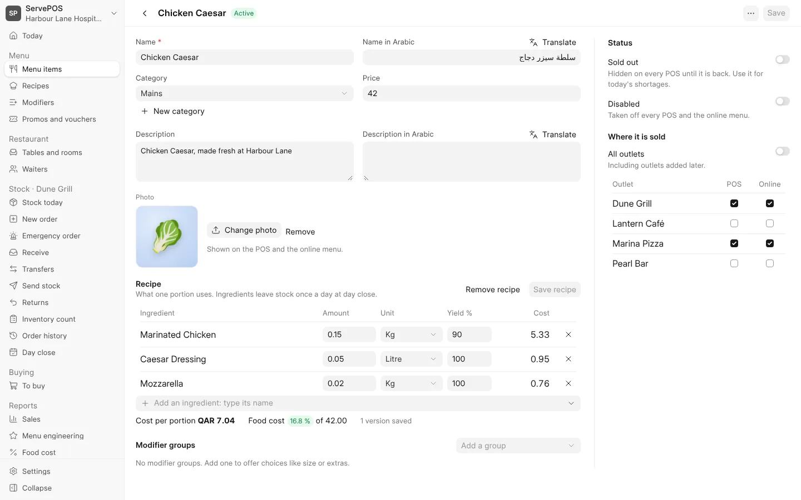
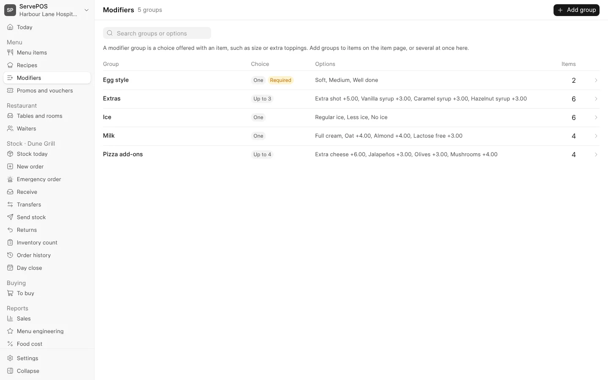
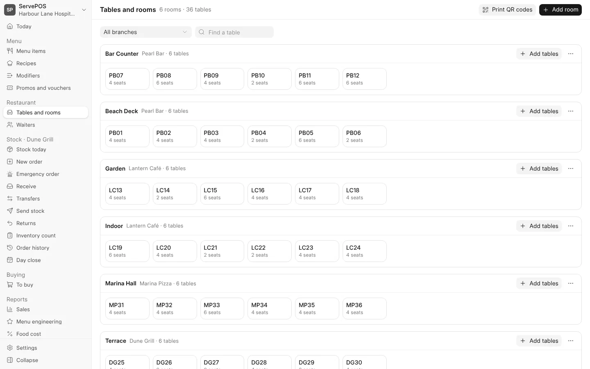

# Your menu

Build the menu in the manager app at `/manage`. Everything you add there is stored in ERPNext (items are normal ERPNext Items) and reaches every POS and waiter app at their next sync, usually within a minute.

You need the **ServePOS Manager** role, or System Manager.

## Menu items and ingredients are different items

ERPNext keeps two kinds of items for a restaurant, and Serve POS keeps them apart:

- **Menu items** are what guests order: *Flat White*, *Chicken Caesar*. They are not kept in stock. The manager app creates them this way.
- **Ingredients** are what you buy and keep in stock: milk, coffee beans, chicken. Create them in ERPNext as normal stock items, in item groups that are not menu categories. They never appear on the POS.

[Recipes](recipes.md) join the two: a recipe says which ingredients one portion of a menu item uses.

## Categories

Menu categories are ERPNext Item Groups marked as menu groups. Only menu categories appear on the POS.

To add one, open **Menu items** › **Add item**, and under **Category** click **New category**. Or use **More** › **Categories and order** on the **Menu items** page, where you can also set the order the categories appear in on each outlet's POS.

> **An existing ERPNext item group** can be a menu category too. In ERPNext, open the Item Group and tick **Is Menu Group (ServePOS)**. As soon as one group is ticked, the POS shows only ticked groups.

## Add a menu item

**Menu items** › **Add item**:

| Field | What to enter |
|---|---|
| **Name** | The English name, for example *Chicken Caesar* |
| **Name in Arabic** | The Arabic name. Click **Translate** to fill it in (see below). |
| **Category** | A menu category |
| **Price** | The selling price. Shown on the POS and used on the Sales Invoice. |
| **Description** and **Description in Arabic** | Optional. Can be printed on receipts and shown on the guest menu. |
| **Item code** | Leave empty: it is made from the name |
| **Photo** | Optional. Shown on the POS and the guest menu. |
| **Where it is sold** | **All outlets** (including outlets you add later), or tick each outlet. **Online** shows it on the guest QR menu too. |

Click **Create**.

### Sold out and disabled

On the item, under **Status**:

- **Sold out**: hidden on every POS until it is back. Use it for today's shortages.
- **Disabled**: taken off every POS and the online menu.

On the **Menu items** list you can select several items and use **Mark sold out**, **Back in stock**, **Move to category**, **Add to outlets** or **Remove from outlets** at once.

### Popular items and order

**More** › **Popular (pinned) items** chooses what appears in the **Popular** tab at the top of the POS for each outlet. **Categories and order** sets the order of categories and items.

### Copy a menu to a new outlet

**More** › **Copy menu between outlets** makes a new outlet sell the same items as another: it can add the other outlet's items (and its order and modifier groups), or replace the new outlet's menu entirely. It shows the counts before it changes anything.

## Arabic names in one tap

The **Translate** buttons next to **Name in Arabic** and **Description in Arabic** write the Arabic for you. Set them up once:

1. Open **Settings** in the manager app.
2. Under **Arabic translation**, choose the service in **Translate with**: *Claude (Anthropic)*, *OpenAI* or *Google Translate*.
3. Paste that service's **API key** and click **Save**. The key stays on the server.

Claude and OpenAI write names the way Gulf menus do: they sound out international names (*Flat White*: فلات وايت) and translate plain words (*Orange Juice*: عصير برتقال). Google Translate translates the meaning. You can always edit the result before saving.

## Modifiers

Modifiers are choices on an item, such as milk type, size or extra toppings. Each choice can add to the price.

1. Open **Modifiers** › **Add group**.
2. **Name**: for example *Milk*.
3. **Guests choose**: one option, or up to a number of options. Tick **Required** if the cashier must choose.
4. Add the **Options**, each with its **Extra price** (0 if free). Mark one **Default** if you like.
5. Choose the **Outlets** it applies to, and **Add to items** to attach it to items.

You can also attach groups from an item's page, under **Modifier groups**.

On the POS, the modifiers are added to the item's line and its price. On the Sales Invoice the item's rate includes them.

## Promos and vouchers

**Promos and vouchers**:

- **Promo**: a discount the cashier picks on the POS, such as *Staff 20 %* or *Partner 10 %*. Choose the outlets it is for.
- **Voucher**: a 6-digit code a guest gives at the POS for a percentage off. **Add voucher** makes one, **Make many codes** makes a batch to print or send. Each voucher has a number of uses and an expiry date, and the list shows how often each was used.

## Tables and rooms

**Tables and rooms** lays out the floor for each outlet:

1. **Add room**, for example *Indoor* or *Terrace*, and choose its **Branch**.
2. In the room, **Add tables**: one by name (*T1*), or many at once with a **Prefix**, **From** and **How many**, and the **Seats** for each.

The POS floor plan, the waiter app and the guest menu all use these tables.

**Print QR codes** makes a printable sheet with one QR code per table. Guests scan it to see the menu, order, or call a waiter. See [Waiter app and guest QR](waiter-app.md).

**Next:** [Install and connect the desktop POS](desktop-pos.md)
