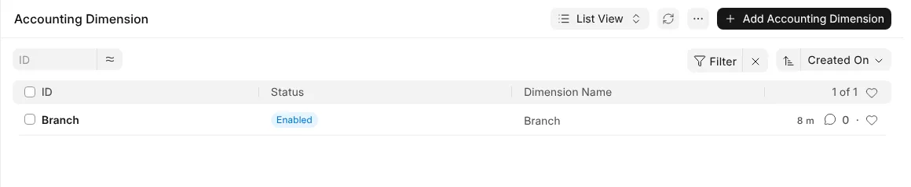
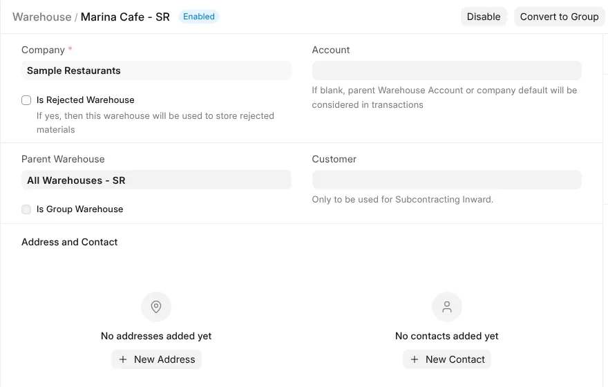
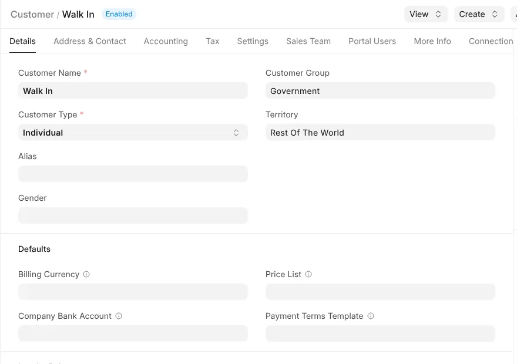
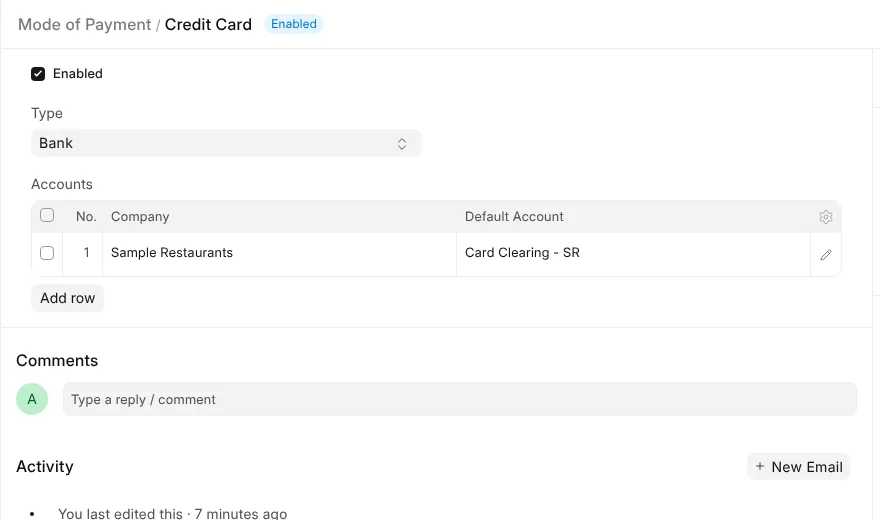
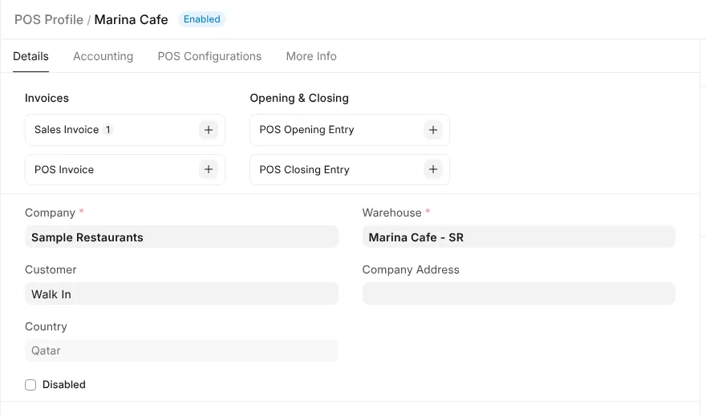
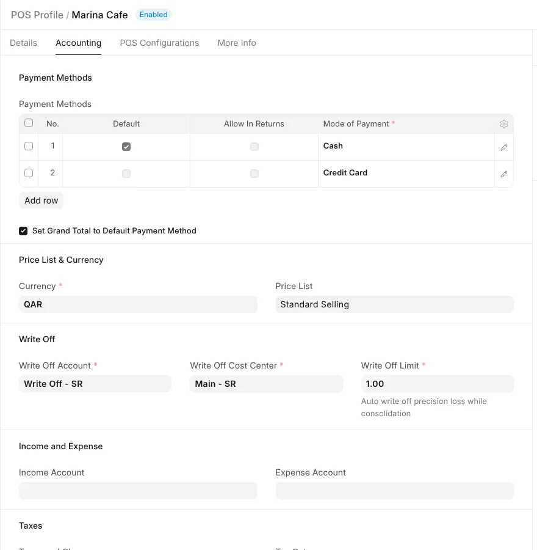
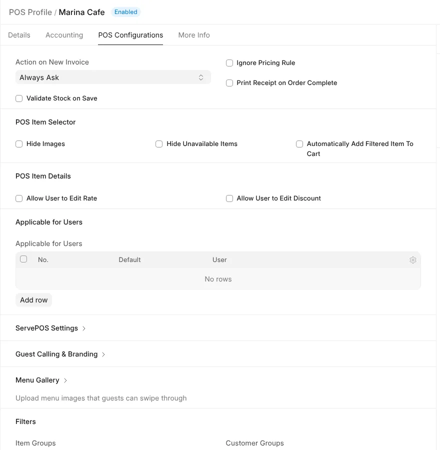

# Set up an outlet in ERPNext

The desktop POS has almost no settings of its own. It reads one **POS Profile** in ERPNext and posts every sale with it: which warehouse the stock comes out of, which customer the sale is for, which payment methods the cashier sees, which accounts and taxes are used, and which branch the sale belongs to.

So before you install the POS, set up each outlet in ERPNext. One outlet needs:

1. The Branch accounting dimension (Serve POS adds it for you)
2. A Branch
3. A warehouse for the outlet (recommended)
4. A walk-in customer (once, shared by all outlets)
5. Payment methods with accounts
6. A tax template, if you charge VAT
7. A POS Profile that ties them together

The examples use an outlet called **Marina Cafe** in a company called **Sample Restaurants** (abbreviation **SR**).

> **Tip:** Search box. In ERPNext, press **Ctrl + K** (or **Cmd + K** on a Mac) and type the name of a list, for example *POS Profile*, to open it.

## 1. Check the Branch accounting dimension

An accounting dimension is a tag that ERPNext puts on every ledger entry. With a **Branch** dimension, every sale, every stock movement and every journal line carries the outlet's branch, so you can read the profit and loss, the sales and the stock of each outlet on its own.

Serve POS creates this dimension when it is installed. To check, open **Accounting Dimension**. You should see **Branch**, enabled.

If it is not there (for example, it was disabled):

1. Open **Accounting Dimension** and click **Add Accounting Dimension**.
2. Set **Reference Document Type** to **Branch** and save.
3. Run `bench --site your.site migrate` (or wait a minute: ERPNext adds the fields in the background).

> **Even with one outlet,** keep the dimension. When you open a second outlet, the history of the first is already tagged.

## 2. Add a Branch for the outlet

Open **Branch**, click **Add Branch**, type the outlet's name (**Marina Cafe**) and save.

## 3. Add a warehouse for the outlet

**Recommended.** Give each outlet its own warehouse and choose it in the outlet's POS Profile (step 7). Each outlet then sells from its own stock, so you can see what each outlet has, what it used and what it is short of.

It is optional: the POS Profile needs a warehouse, but it can be one you already have, such as *Stores - SR*. Use that only if you do not track stock per outlet, for example a single café that keeps everything in one store.

1. Open **Warehouse** and click **Add Warehouse**.
2. **Warehouse Name**: *Marina Cafe*. ERPNext saves it as *Marina Cafe - SR*.
3. **Parent Warehouse**: *All Warehouses - SR*.
4. Save.

If you will use [stock orders](stock-orders.md), also add a warehouse for the store and each kitchen that supplies the outlets. ERPNext already has **Goods In Transit - SR**, which stock orders use while goods are on the way.

## 4. Add a walk-in customer

Most restaurant sales are not for a named customer. ERPNext still needs a customer on each invoice, so create one customer for all of them.

1. Open **Customer** and click **Add Customer**.
2. **Customer Name**: *Walk In*.
3. **Customer Type**: *Individual*.
4. **Customer Group** and **Territory**: any, for example *Individual* and *All Territories*.
5. Save.

You will choose this customer in the POS Profile. If a POS Profile has no customer, the POS uses a customer called *Walk In*, so the name matters.

## 5. Check the payment methods

Every payment method the cashier can choose needs an account in your company, so ERPNext knows where the money goes.

1. Open **Mode of Payment** and open **Cash**. The setup wizard already linked it to *Cash - SR*.
2. Open **Credit Card**. In the **Accounts** table, add a row: **Company** *Sample Restaurants*, **Default Account** a bank or clearing account such as *Card Clearing - SR*. (Create the account first under *Bank Accounts* in the **Chart of Accounts** if you do not have one, with **Account Type** *Bank*.)
3. Do the same for any other method you take, such as a delivery app or room charge: add a **Mode of Payment** with **Type** *Bank* or *General* and an account for your company.

> **If you skip this,** the sale is saved on the POS but cannot post to ERPNext. The POS shows it as *failed to sync* with a message about the missing account. Add the account and the POS sends it again.

## 6. Add a tax template, if you charge VAT

If your prices carry VAT (for example 5 % in Oman, the UAE or Bahrain), create a **Sales Taxes and Charges Template** with your VAT account and rate. You choose it in the POS Profile in the next step.

In Qatar there is no VAT today, so leave this out.

The tax shown on the receipt is set in the POS itself, in [Receipt and ticket layout](print-format.md#tax). Use the same rate in both places.

## 7. Create the POS Profile

The POS Profile is the outlet. Open **POS Profile** and click **Add POS Profile**.

### Details tab

| Field | What to enter |
|---|---|
| **Name** | The outlet's name, for example *Marina Cafe*. Cashiers see this name. |
| **Company** | Your company |
| **Customer** | *Walk In* |
| **Warehouse** | The outlet's warehouse, *Marina Cafe - SR* (recommended), or an existing one such as *Stores - SR* |

### Accounting tab

| Field | What to enter |
|---|---|
| **Payment Methods** | Add a row for each method the cashier can use: *Cash* (tick **Default**), *Credit Card*, and any others. They appear on the POS payment screen in this order. |
| **Currency** | Your currency, for example *QAR* |
| **Price List** | *Standard Selling* |
| **Write Off Account** and **Write Off Cost Center** | *Write Off - SR* and *Main - SR*. Used for rounding differences. |
| **Income Account** | Leave empty to use the item's or company's default sales account, or pick an outlet sales account |
| **Taxes and Charges** | Your VAT template from step 6, if any |
| **Account for Change Amount** | Your cash account, so change given back to guests is recorded |
| **Cost Center** | *Main - SR*, or a cost center for the outlet |
| **Branch** | **Marina Cafe**. This is what gives the outlet its own sales and P&L. |

### POS Configurations tab

The ERPNext settings at the top of this tab (such as **Applicable for Users**) are for ERPNext's own POS screen. Serve POS does not use them, so you can leave them as they are.

Lower down, two sections belong to Serve POS:

- **ServePOS Settings**: kitchen display times kept for older screens. The desktop POS does not use them, so you can leave them as they are.
- **Guest Calling & Branding**: the name, description and logo guests see on the table QR menu, the hours the outlet takes guest orders, and which waiter receives online orders. See [Waiter app and guest QR](waiter-app.md).

Save the POS Profile.

## Repeat for each outlet

For a second outlet, add its Branch, its warehouse (recommended) and its POS Profile. The walk-in customer and the payment method accounts are shared.

If an outlet has two counters (for example a bar and a pool counter), you can give each its own POS Profile with the same branch, or use one profile on two POS computers with different terminal numbers. Use two profiles if the counters sell from different warehouses or see different menus.

## What you get

Every POS sale becomes a submitted **Sales Invoice** with the POS Profile, the outlet's warehouse, **Update Stock** and the payment. ERPNext then writes the ledger entries itself, all tagged with the branch:

| Account | Debit | Credit | Branch |
|---|---|---|---|
| Cash - SR | 36.00 | | Marina Cafe |
| Sales - SR | | 36.00 | Marina Cafe |

*(From a test sale on a fresh site: two Flat Whites, paid in cash.)*

To see one outlet's results, open **Profit and Loss Statement** (or **General Ledger**, **Gross Profit**, **Sales Register**) and set the **Branch** filter.

**Next:** [Users and roles](users.md)
