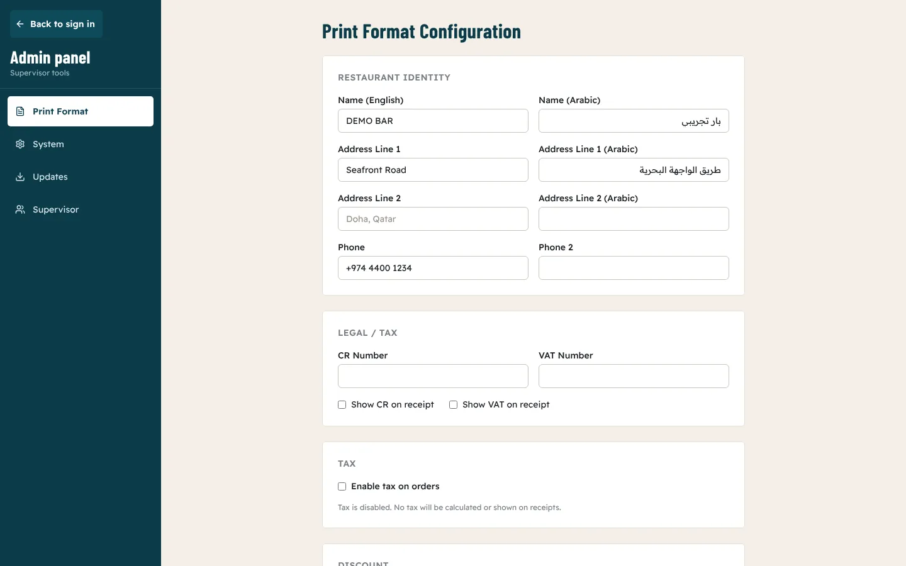
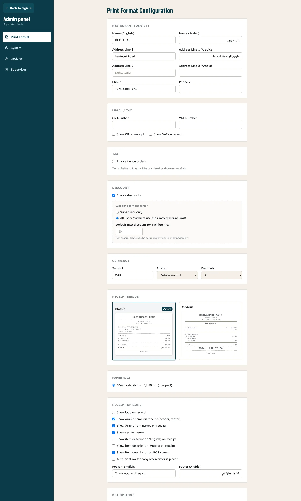

# Receipt and ticket layout

What the receipt, bill and kitchen ticket look like is set on each POS, in **Supervisor tools** › **Print Format**. Which printer they go to is set in [Printers](printers.md).

1. On the POS sign-in screen, click **Supervisor tools**.
2. Sign in with the POS admin account (made during [first-time setup](desktop-pos.md#step-1-admin-account)).
3. Open the **Print Format** tab. Change what you need and click **Save Changes** at the bottom.

Set this up on every POS computer. If two POS at an outlet should print the same, enter the same values on both.

## Restaurant identity

The top of every receipt and bill:

| Field | Example |
|---|---|
| **Name (English)** and **Name (Arabic)** | *Marina Cafe*, *مارينا كافيه* |
| **Address Line 1** and **2**, in English and Arabic | *Tower 12, The Pearl*, *Doha, Qatar* |
| **Phone** and **Phone 2** | *+974 4444 5555* |

## Legal and tax

| Field | What it does |
|---|---|
| **CR Number** | Your commercial registration number. Tick **Show CR on receipt** to print it. |
| **VAT Number** | Your tax registration number. Tick **Show VAT on receipt** to print it. |

### Tax

Leave **Enable tax on orders** off if you do not charge VAT. If you do:

1. Tick **Enable tax on orders**.
2. **Tax Label**: *VAT*.
3. **Tax Rate (%)**: for example *5*.

The POS adds the tax **on top of** the menu prices, after discounts, and prints it as its own line. In ERPNext, use a **Sales Taxes and Charges Template** with the same rate, **Type** *On Net Total*, and **Is this Tax included in Basic Rate?** left unticked, and choose it in the outlet's POS Profile ([outlet setup](outlet-setup.md#6-add-a-tax-template-if-you-charge-vat)). Then the POS total and the Sales Invoice total match.

## Discounts

| Field | What it does |
|---|---|
| **Enable discounts** | Shows **Add discount** on the POS |
| **Who can apply discounts?** | *Supervisor only*, or *All users*: cashiers can then give up to their own limit |
| **Default max discount for cashiers (%)** | The limit for new cashiers. Each cashier's own limit is set in **Settings** › **Cashiers**. |

## Currency

| Field | What it does |
|---|---|
| **Symbol** | *QAR*, *OMR*, *ر.ق*... |
| **Position** | Before or after the amount |
| **Decimals** | *Auto* uses 3 decimals for OMR, KWD and BHD and 2 for other currencies. Or choose 0, 2 or 3. |

The manager app takes its decimals from ERPNext (**System Settings** › **Currency Precision**, or the currency's number format), so set both the same way.

## Receipt design

Two designs. Click one to make it active; the preview shows how it prints.

- **Classic**: compact, centred header, item lines with quantity and amount.
- **Modern**: a *TAX INVOICE* heading, CR and VAT under the name, the order type, numbered lines with quantity × price.

## Paper size

**80mm (standard)** or **58mm (compact)**. Match your printer's paper. Lines are laid out for the width you choose.

## Receipt options

| Option | What it does |
|---|---|
| **Show Arabic name on receipt (header, footer)** | Prints the Arabic name, address and footer |
| **Show Arabic item names on receipt** | Prints each item's Arabic name under the English one |
| **Show cashier name** | Prints who took the payment |
| **Show item description (English)** and **(Arabic)** | Prints each item's description |
| **Show item description on POS screen** | Shows descriptions on the item tiles |
| **Auto-print waiter copy when order is placed** | Prints a copy for the waiter on the receipt printer when the order is sent |
| **Footer (English)** and **Footer (Arabic)** | The last lines, for example *Thank you, see you soon* |

Arabic names come from the menu ([Your menu](menu.md#arabic-names-in-one-tap)).

## KOT options

For kitchen tickets:

| Option | What it does |
|---|---|
| **Show order number on KOT** | The order number, to match the ticket with the order |
| **Show table on KOT** | The table, so runners know where it goes |
| **Show restaurant name on KOT** | Useful when one kitchen cooks for several outlets |
| **Show Arabic item names on KOT** | For kitchen staff who read Arabic |
| **KOT Font Size** | *Normal* or *Large*. Large is easier to read from across a kitchen. |

Modifiers and the cashier's notes always print under each item, so the kitchen sees *oat milk, extra shot*.

## Print document settings

| Option | What it does |
|---|---|
| **Auto-accept waiter orders** | Orders from the waiter app and the guest QR menu go straight to the kitchen and print. Off: the cashier accepts each one first. |
| **Enable Preparation Document** | Turns on the preparation slip, without prices, for the people who assemble orders ([Kitchen](kitchen.md#preparation-slips)) |
| **Auto-print Prep Doc on order** | Prints the preparation slip with each KOT |
| **Auto-print Receipt on payment** | Prints the receipt as soon as payment is confirmed. Off: the cashier prints it when the guest wants one. |
| **Hold sends to the kitchen** | Off (default): **Hold** saves the order and its new items stay *Not sent* until **Send**. On: **Hold** also prints the KOT. |
| **Direct pay (no KOT)** | Who sees the **Direct pay** button: *Everyone*, cashiers with a *Supervisor PIN*, or *Off*. Direct pay prints only the receipt; the kitchen gets nothing. |

## Number of copies

How many copies each print type prints, 1 to 5: **KOT**, **Prep Doc**, **Invoice** (the bill) and **Receipt**. For example, 2 receipts if you keep one for your records.

## Printing from ERPNext (A4 invoices)

Every POS sale is a Sales Invoice in ERPNext, so you can also print it on A4, for example when a company guest asks for a tax invoice:

1. Open the Sales Invoice in ERPNext (filter by **POS Order Number**, which is on the receipt).
2. Click **Print** and choose a print format and **Letter Head**.

To put your logo and address on these, create a **Letter Head** in ERPNext. To change the layout, use ERPNext's **Print Format Builder** on **Sales Invoice**. If you set **Letter Head** on the POS Profile, every POS invoice uses it.

**Next:** [Kitchen](kitchen.md)
