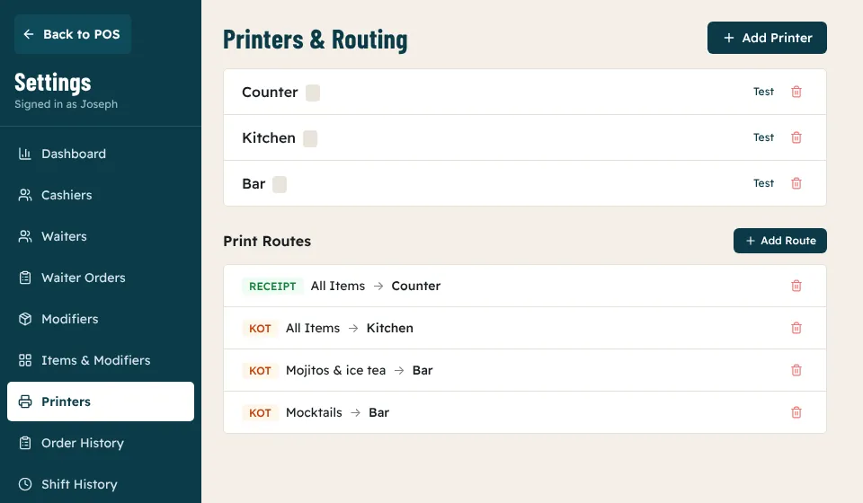
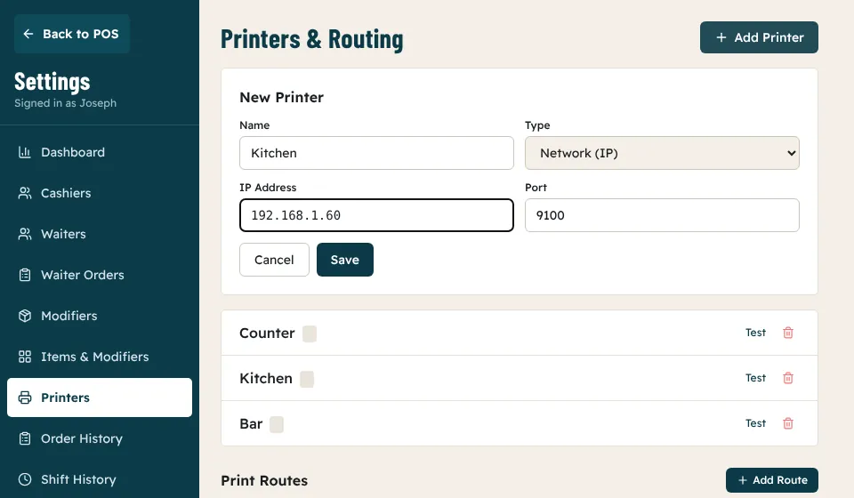
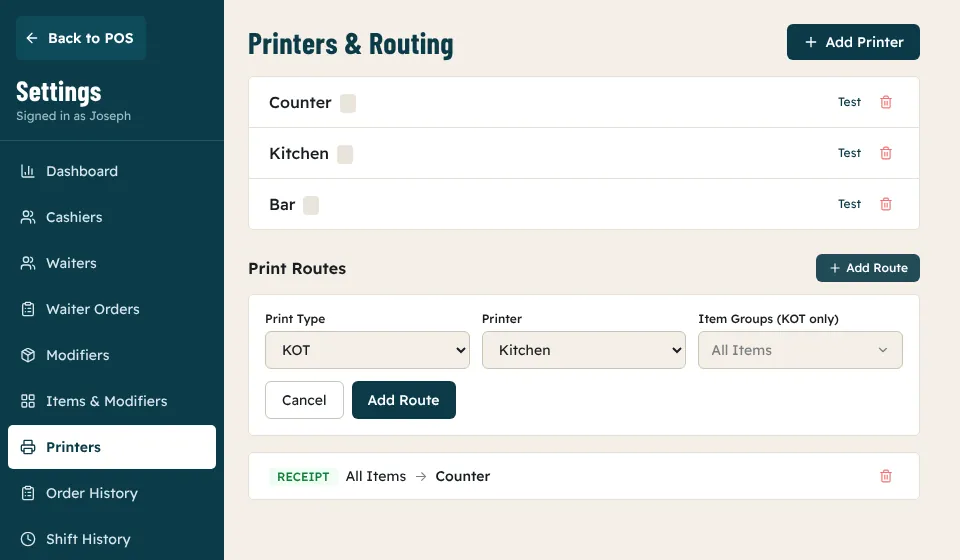
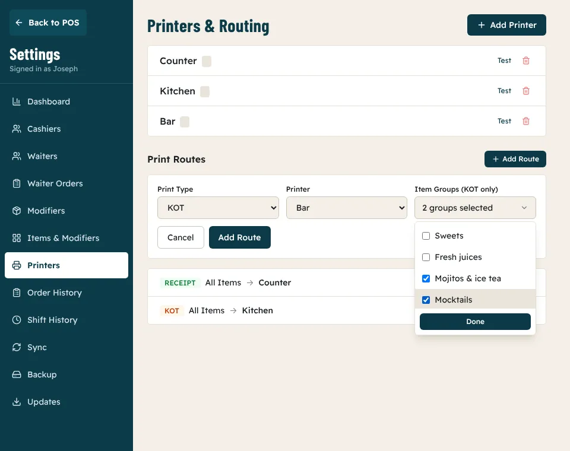

# Printers

The desktop POS prints straight to thermal printers: receipts and bills at the counter, and kitchen tickets (KOTs) in each kitchen or bar. It does not go through ERPNext, so printing keeps working when the internet is down.

Printers are set up **on each POS computer**, in two parts:

1. **Printers**: tell the POS which printers exist and how to reach them.
2. **Print routes**: tell it which printer gets which kind of paper, and which kitchen gets which items.

You need a supervisor PIN. Sign in, click your name at the top right › **Settings** › **Printers**.

## Which printers work

Any thermal receipt printer that understands **ESC/POS** commands, which is nearly all of them. 80 mm paper is standard; 58 mm also works (set it in [Receipt and ticket layout](print-format.md#paper-size)).

Connect each printer one of two ways:

| Connection | Best for | What the POS needs |
|---|---|---|
| **Network (Ethernet or Wi-Fi)** | Kitchen and bar printers, and any printer shared by two POS computers | Its IP address. The port is almost always 9100. |
| **USB** | A receipt printer next to one POS | The printer installed on the computer, and its exact name |

**Arabic prints on any of them.** The POS draws Arabic text as an image, so the printer does not need Arabic fonts or a code page setting.

**The cash drawer** plugs into the receipt printer (the RJ11 port at the back). The POS opens it whenever it prints a receipt.

## Before you start: give network printers a fixed address

A network printer must keep the same IP address, or the POS loses it after a power cut.

1. Print the printer's **self-test page**. On most models: switch it off, hold the **Feed** button, switch it on, and release after a second. The page shows its IP address.
2. Either set a **static IP** on the printer (with the maker's tool or its web page), or ask whoever looks after your router to **reserve** that address for the printer.
3. Make sure the POS computer and the printer are on the **same network**.

> **Quick check:** from the POS computer, open a command prompt and type `ping 192.168.1.60` (your printer's address). If you get replies, the POS can reach it.

## 1. Add each printer

Click **Add Printer**.

### A network printer

| Field | What to enter |
|---|---|
| **Name** | What staff call it: *Kitchen*, *Bar*, *Counter* |
| **Type** | **Network (IP)** |
| **IP Address** | From the self-test page, for example `192.168.1.60` |
| **Port** | `9100` |

### A USB printer

First install the printer on the computer with the maker's driver, so it appears in **Windows Settings** › **Bluetooth & devices** › **Printers & scanners** (or in **System Settings** › **Printers & Scanners** on a Mac). Then:

| Field | What to enter |
|---|---|
| **Name** | *Counter* |
| **Type** | **USB** |
| **Printer Name** | Click **Detect Printers** and pick it from the list. Or type the name exactly as Windows shows it, for example `POS-80C`. |

Click **Save**, then **Test** next to the printer. A test page should come out. If it does not, see [Troubleshooting](troubleshooting.md#nothing-prints).

## 2. Route the printing

A route says: *this kind of paper goes to this printer*. Click **Add Route**, choose the **Print Type** and the **Printer**, and click **Add Route** again.

There are four print types:

| Print type | What it is | When it prints | If there is no route for it |
|---|---|---|---|
| **Receipt** | The guest's receipt after payment | On **Pay** (automatically, if *Auto-print Receipt on payment* is on) | **Needed.** Without it, receipts, void slips and shift reports cannot print. |
| **KOT** | The kitchen order ticket | On **Send**, and when a waiter order is accepted | **Needed** if you have a kitchen. |
| **Invoice** | The bill, before payment | On **Print bill** | Prints on the receipt printer |
| **Prep Doc** | A slip without prices for the people who assemble the order | With each KOT, if turned on ([Kitchen](kitchen.md#preparation-slips)) | Prints on the receipt printer |

The receipt printer also prints the waiter copy, void slips, split-bill shares and the closing voucher of each shift.

### Send each kitchen its own items

With one kitchen, add one **KOT** route to the kitchen printer and leave **Item Groups** on *All Items*.

With several kitchens, choose which menu categories go to which printer. For example, a kitchen and a bar:

1. **KOT** › **Kitchen** › *All Items*. This is the catch-all: anything not routed elsewhere goes here.
2. **KOT** › **Bar** › tick the drink categories (*Coffee*, *Mocktails*, *Fresh juices*...), click **Done**, then **Add Route**. The POS makes one route per category.

When a cashier sends an order with a Caesar salad and two mojitos, the kitchen prints a ticket with the salad and the bar prints a ticket with the mojitos. Each printer gets one ticket per order with only its items, at the same time.

How the POS picks the printer for each item:

1. A KOT route for the item's **category**, if there is one.
2. Otherwise the **catch-all** KOT route (the one with *All Items*).
3. With no catch-all, the first KOT route you added.

> **Always keep a catch-all KOT route.** A new category you add later then goes to the kitchen instead of being missed.

When an order is changed after it was sent (an item added or removed), the change ticket prints on the first KOT printer, so the kitchen sees what changed.

### Number of copies

Each print type can print 1 to 5 copies, for example two KOTs for a kitchen with two stations. Set them in **Supervisor tools** › **Print Format** › **Number of copies** ([Receipt and ticket layout](print-format.md#number-of-copies)).

## Two POS computers at one outlet

Printers and routes are kept on each POS. Set them up on each computer. Two POS can share network printers: give both the same IP addresses.

## Checking the printers during service

The status bar at the top of the POS shows **Printers** with how many are set up, or **No printer set up**. Use **Test** in **Settings** › **Printers** to check one. If a ticket fails, the POS keeps it and shows a message with **Retry**, so nothing is lost while someone checks the paper or the cable.

**Next:** [Receipt and ticket layout](print-format.md)
