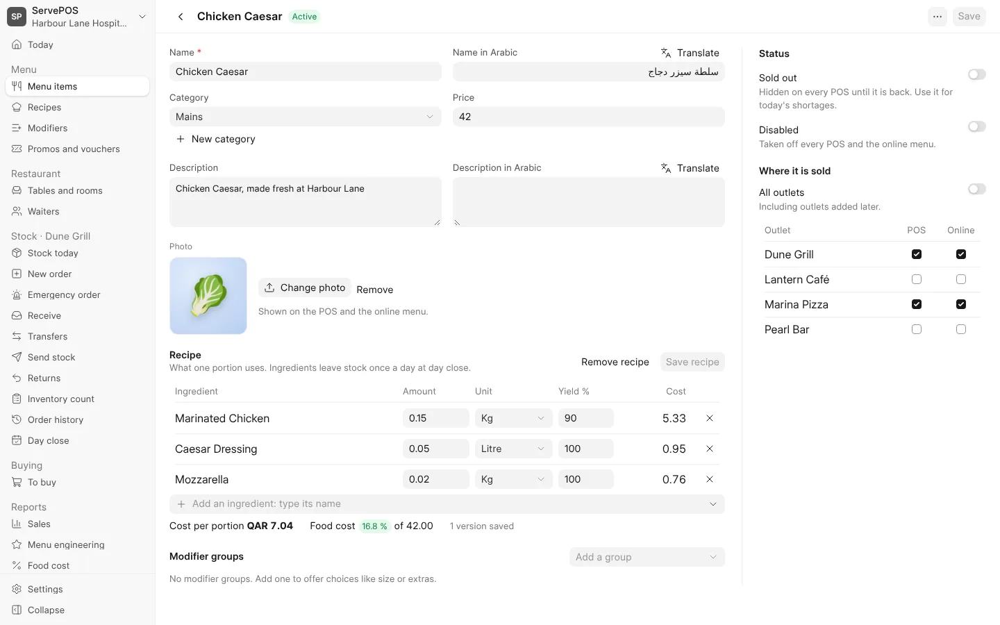
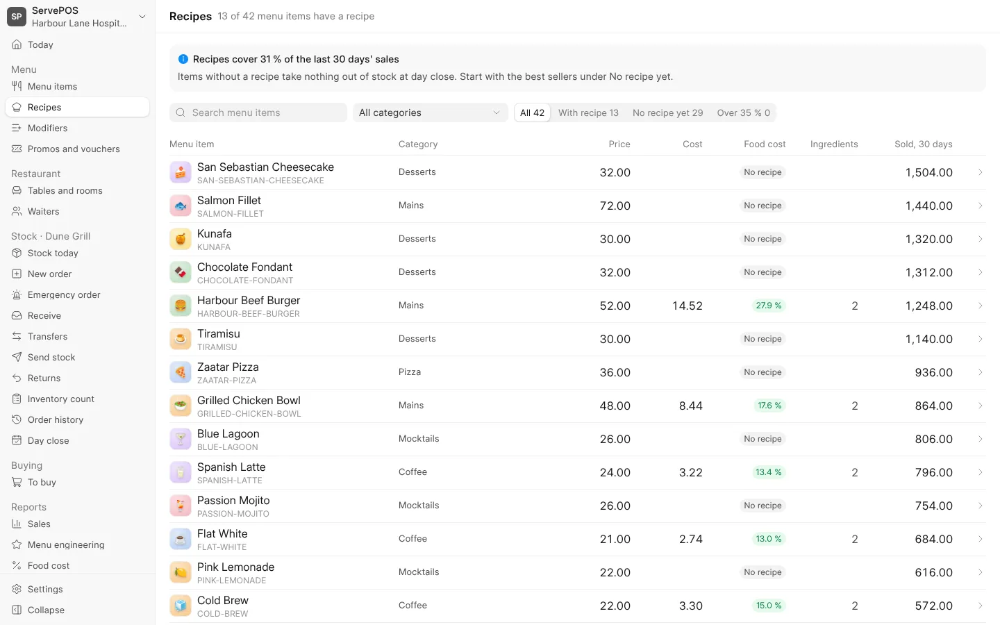
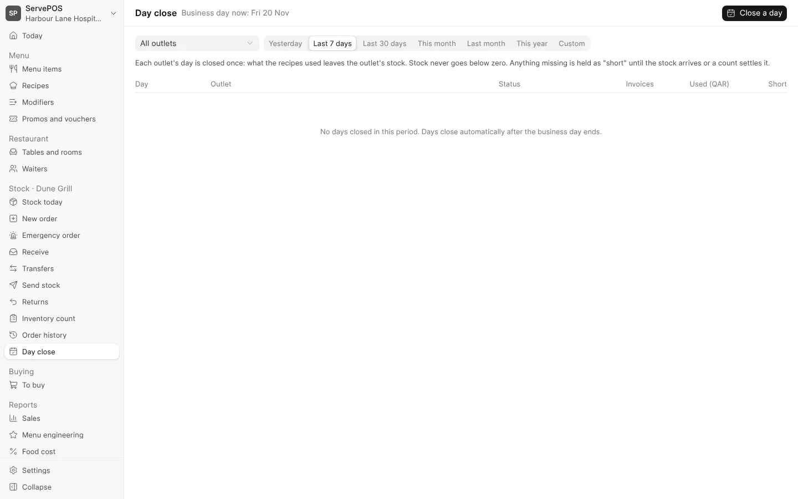
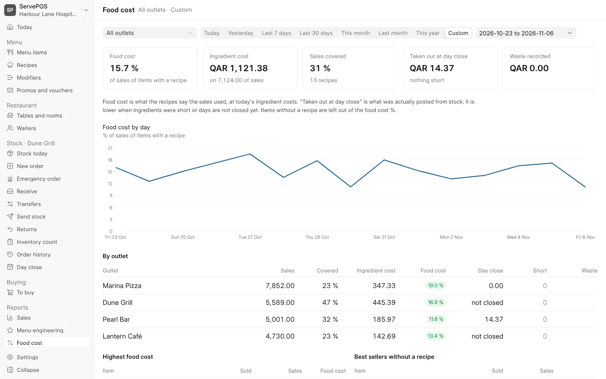
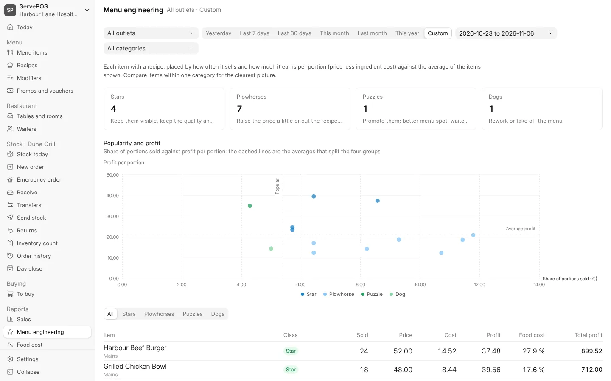

# Recipes and food cost

A recipe says what one portion of a menu item uses: *Chicken Caesar = 150 g marinated chicken, 50 ml dressing, 20 g parmesan*. With recipes, Serve POS can:

- show the **cost** and **food cost %** of every dish,
- take the ingredients **out of stock** once a day, at day close,
- place every dish on the **menu engineering** chart, and
- report **food cost** by outlet and by day.

## Before you start: ingredients and their costs

Ingredients are normal ERPNext stock items (see [Your menu](menu.md#menu-items-and-ingredients-are-different-items)). Their cost is ERPNext's **valuation rate**, which comes from your purchase receipts and stock entries. If an ingredient has never been bought or valued in ERPNext, its cost is zero, so receive your opening stock first.

## Add a recipe

1. In the manager app, open **Menu items** and open the item, or open **Recipes** and pick it.
2. Under **Recipe**, type an ingredient's name and pick it.
3. Enter the **Amount** one portion uses and its **Unit** (kg, litre, piece...).
4. **Yield %**: how much of what you buy you can use. Lettuce you trim by a fifth has a yield of 80 %: the recipe then takes a bit more out of stock to cover the trim.
5. Add the other ingredients and click **Save recipe**.

Under the table, the manager app shows the **cost per portion** and the **food cost %** against the price. Each save keeps a new version (in ERPNext it is a Bill of Materials), so past costs stay as they were.

A recipe can use another prepared item, such as a dressing that has its own recipe. Serve POS works out the cost through every level.

## The Recipes page

**Recipes** lists every menu item with its price, cost, food cost % and sales in the last 30 days. The tabs show **With recipe**, **No recipe yet** and **Over 35 %**. The banner shows how much of your sales the recipes cover.

Start with the best sellers under **No recipe yet**: a few recipes usually cover most of the sales.

## Day close: ingredients leave stock

The POS does not take ingredients out of stock with each sale. Once a day, after the business day ends, Serve POS adds up what each outlet sold, works out the ingredients from the recipes, and posts one **Stock Entry** (purpose *Material Issue*) from the outlet's warehouse.

- Items sold without a recipe take nothing out of stock. The day close lists them.
- If an ingredient is short in the warehouse, stock never goes below zero: the missing quantity is kept as **short** until the stock arrives or a count settles it. **Try short items again** posts it later.
- **Undo this close** reverses a day close, for example after correcting a recipe.

Open **Day close** in the manager app to see each outlet's days, what was used, and what is short. **Close a day** closes one by hand.

### Day close settings

In the manager app, open **Settings** › **Stock and day close**:

| Setting | What it does |
|---|---|
| **Business day starts at (hour)** | Sales before this hour count for the evening before, so a night that ends at 2 am is one business day. Day close runs after this hour. |
| **Close each day automatically** | Closes every outlet's day by itself |
| **Wait for deliveries not yet received** | Off: close and warn. On: the day stays open while a delivery to the outlet is still on its way. |
| **Food cost account** | Where ingredients used are expensed. Empty: the company's stock adjustment account. |
| **Waste account** | Where recorded waste is expensed |

## Food cost

**Reports** › **Food cost** shows, for an outlet and a period:

- **Food cost %**: what the recipes say the sales used, at today's ingredient costs, against the sales of items with a recipe
- **Ingredient cost**, **Sales covered** by recipes, what day close **took out** of stock, and **waste**
- **Food cost by day** and **By outlet**
- The dishes with the **highest food cost**, and the **best sellers without a recipe**

## Menu engineering

**Reports** › **Menu engineering** places every dish with a recipe by how often it sells and how much it earns per portion (price less ingredient cost), against the average:

| Group | Popular? | Profitable? | What to do |
|---|---|---|---|
| **Stars** | Yes | Yes | Keep them visible, keep the quality and portion steady |
| **Plowhorses** | Yes | No | Raise the price a little or cut the recipe cost |
| **Puzzles** | No | Yes | Promote them: a better menu spot, a waiter suggestion, a new name |
| **Dogs** | No | No | Rework them or take them off the menu |

Compare dishes within one category (choose it at the top) for the clearest picture. Click a dish to open its recipe.

**Next:** [Stock orders](stock-orders.md)
