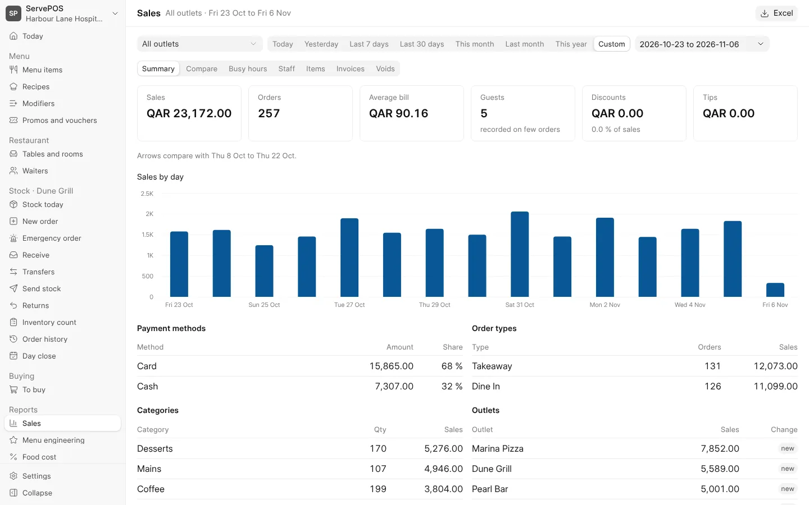

# Reports

Every number in Serve POS comes from the Sales Invoices in ERPNext, so the reports always match your books.

People with **ServePOS Manager** or **ServePOS Reporter** see the reports in the manager app. A user limited to some outlets (see [Users and roles](users.md#limit-a-user-to-one-outlet)) sees only those.

## Today

The manager app opens on **Today**: sales, orders, average bill, guests, tips and voids for all outlets or one, with sales by hour, payments, each outlet's last sync and the top items.

If an outlet shows amber under **Last sale synced**, nothing has arrived from it for a while: the POS may be offline or closed.

## Sales

**Sales** covers any period: today, yesterday, the last 7 or 30 days, this month, last month, this year, or your own dates. Pick an outlet or all of them.

| Tab | What it shows |
|---|---|
| **Summary** | Totals, sales by day, by outlet, by payment method and by order type |
| **Compare** | This period against the one before, the same dates last year, or dates you choose: every figure with its change, outlets side by side, categories, and the items selling more and less |
| **Busy hours** | Orders by hour and weekday as a heat map, to plan staff |
| **Staff** | Sales by cashier and waiter |
| **Items** | What sold, how many and for how much |
| **Invoices** | Each sale, linked to its Sales Invoice |
| **Voids** | Each void, who did it and why |

**Excel** at the top right downloads what you see.

## Food cost and menu engineering

From the recipes: see [Recipes and food cost](recipes.md#food-cost).

## ERPNext reports by outlet

Because every sale, stock movement and journal line carries the outlet's **Branch**, ERPNext's own reports work per outlet. Set the **Branch** filter on:

- **Profit and Loss Statement**: each outlet's P&L
- **General Ledger** and **Trial Balance**
- **Gross Profit**: margin by item, at cost
- **Sales Register** and **Item-wise Sales Register**
- **Stock Balance** and **Stock Ledger**, filtered by the outlet's warehouse

**Next:** [Troubleshooting](troubleshooting.md)
