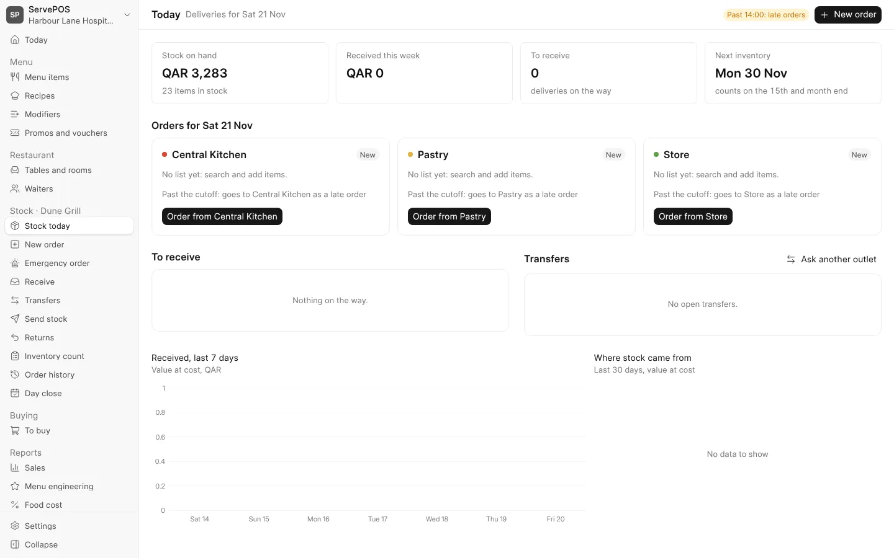
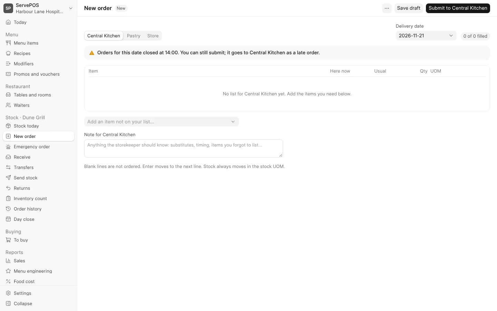

# Stock orders

For groups where a store and central kitchens supply the outlets. Each outlet orders what it needs every day, the kitchens make and ship it, and the outlets confirm what arrived. Every step is a normal ERPNext stock document, so stock is right in every warehouse.

You can skip this page if your outlets buy for themselves.

## How it fits together

| Place | Role in ERPNext | What it does |
|---|---|---|
| **Store** | A provider that buys from suppliers | Ships ingredients; its shortages go on the **To buy** list |
| **Central kitchen**, **Pastry kitchen** | Providers | Make and ship prepared food to the outlets |
| **Goods In Transit** | A warehouse | Holds stock between shipping and receiving |
| **Outlets** | Outlets | Order, receive, count |

Every place is a warehouse, so ERPNext always knows where the food is.

## Set it up

### 1. Stock locations

Open **ServePOS Stock Location** in ERPNext and add one for each outlet, for the store and for each kitchen:

| Field | What to enter |
|---|---|
| **Location Name** | *Central Kitchen* |
| **Type** | **Provider** for the store and kitchens, **Outlet** for outlets |
| **POS Profile** | For an outlet: its POS Profile |
| **Warehouse** | Its warehouse |
| **Branch** | Its branch, so its stock and costs post to the right place |
| **Buys from suppliers** | Tick for the store: its shortages appear on the **To buy** list |
| **Orders raw materials from** | For a kitchen: where it gets its ingredients (usually the store) |
| **Item groups supplied** | The item groups outlets can order from this provider. Empty: all its items. |
| **Role that ships** | The role whose users ship from here, for example **ServePOS CK Provider** |
| **Record production when stock is short** | For kitchens: if ERPNext shows less than is shipped, the missing quantity is first recorded as made in the kitchen |

### 2. Users

Give each person their role ([Users and roles](users.md)) and a **User Permission** on their warehouse:

- Outlet managers: **ServePOS Outlet User**, permission on the outlet's warehouse
- Central and pastry kitchen staff: **ServePOS CK Provider** or **ServePOS Pastry Provider**, permission on the kitchen's warehouse
- The storekeeper and buyer: **ServePOS Supervisor** or **ServePOS Manager**

Outlet users do not see prices.

### 3. Settings

In the manager app, **Settings** › **Stock and day close**:

| Setting | What it does |
|---|---|
| **Changes close at** and **Orders close at** | The daily cut-off. Orders after it follow **Orders after cutoff** (for example, go to the next day). |
| **Orders per provider per day** | How many orders an outlet can send each provider each day |
| **In-transit warehouse** | Usually *Goods In Transit* |
| **Short delivery** | What happens when less arrives than was shipped |
| **Write-off account** | Where written-off shortages are expensed |
| **Provider markup** | Optional: add a markup to what kitchens ship, in reports or in the accounts |
| **Inventory days** | The days of the month outlets count stock, for example `15,end` |

## Day to day

**Outlet manager**, in the morning, in **Stock today**:

1. Click **Order from Central Kitchen** (or the pastry kitchen, or the store). The usual items are listed; type the quantities and send before the cut-off.
2. Something urgent after the cut-off? **Emergency order**.
3. When the delivery arrives: **Receive**, check each line, and confirm. If something is short, say so. The short line goes back to the kitchen to settle.

**Kitchen**: open the **picking sheet**: every item, every outlet, the total and what is in stock. Make it, then **Send stock** to each outlet. ERPNext moves it into **Goods In Transit**.

**Storekeeper and buyer**: **To buy** lists what the store is short of, with quantities and suppliers. Turn it into ERPNext **Purchase Orders** from the same screen.

Also in the stock screens:

- **Transfers**: move stock between two outlets
- **Returns**: send stock back to a provider
- **Inventory count**: count on a phone; ERPNext gets a **Stock Reconciliation**
- **Order history**: every order and its status

### What ERPNext records

| Step | ERPNext document |
|---|---|
| Kitchen ships | Stock Entry, *Material Transfer* into Goods In Transit |
| Outlet receives | Stock Entry, *Material Transfer* into the outlet |
| A shortage is written off | Stock Entry, *Material Issue* |
| A count | Stock Reconciliation |
| The store buys | Purchase Order |

**Next:** [Reports](reports.md)
