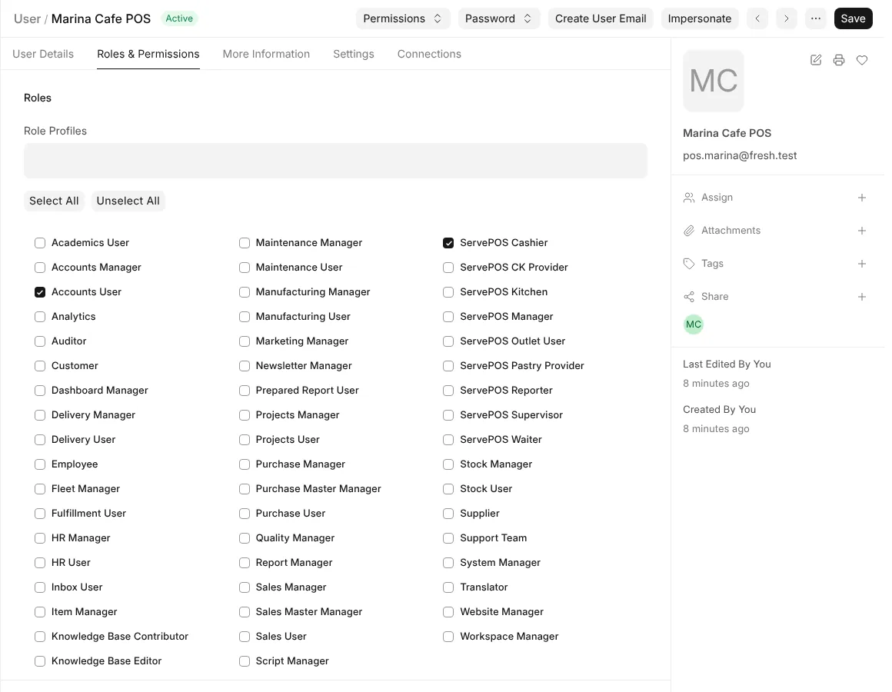
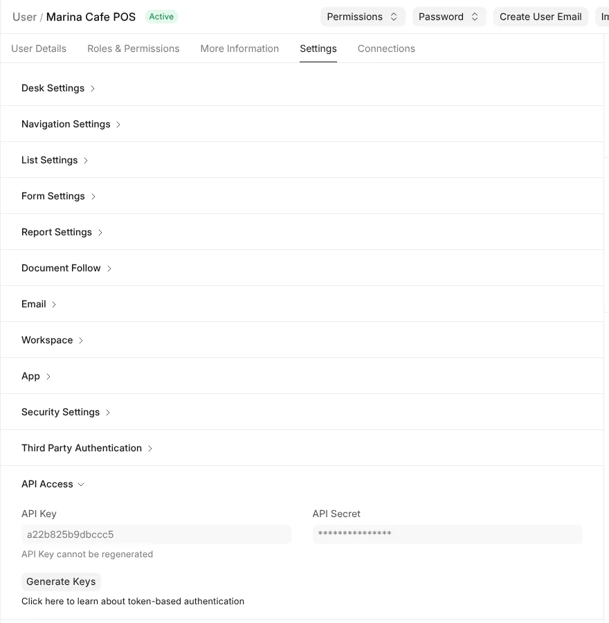

# Users and roles

Serve POS has four kinds of people, and each signs in a different way.

| Who | Signs in to | With | Created in |
|---|---|---|---|
| Owners, managers, storekeepers, accountants | ERPNext and the manager app (`/manage`) | Their ERPNext email and password | ERPNext **User** |
| The POS computer itself | ERPNext, in the background | An API key and secret | ERPNext **User**, one per outlet |
| Cashiers and supervisors | The desktop POS | A PIN | The desktop POS |
| Waiters | The waiter app | A username and password | The manager app, **Waiters** |
| Kitchen pass | The desktop POS kitchen screen | A PIN | The desktop POS |

## Roles for ERPNext users

Give each person the roles for their job. Open **User**, open the person, go to **Roles & Permissions** and tick the roles.

| Role | What it is for |
|---|---|
| **ServePOS Manager** | The whole manager app: menu, recipes, tables, waiters, offers, settings, stock and reports. |
| **ServePOS Reporter** | Reports in the manager app, without changing anything. For owners and accountants. |
| **ServePOS Supervisor** | An outlet supervisor's stock screens. Opens on the stock home page. |
| **ServePOS Outlet User** | An outlet's stock orders: order, receive, count. |
| **ServePOS CK Provider** | The central kitchen: the picking sheet, shipping to outlets. |
| **ServePOS Pastry Provider** | The pastry kitchen, the same as the central kitchen. |
| **ServePOS Cashier** | The POS user (below). |
| **ServePOS Waiter** | Waiter app logins. The manager app adds it for you. |
| **ServePOS Kitchen** | Kitchen staff accounts in ERPNext. The kitchen screen on the POS does not need it: it uses a POS PIN (see [Kitchen](kitchen.md)). |

**System Manager** and the **Administrator** see everything.

### Limit a user to one outlet

To let a manager or storekeeper see only their outlet, add a **User Permission**: open **User Permission**, click **Add User Permission**, pick the user, set **Allow** to *POS Profile* (or *Warehouse* for stock roles) and **For Value** to the outlet. Add one row per outlet they may see.

## The POS user and its API key

The desktop POS does not sign in with a person's password. It uses an API key that belongs to an ERPNext user. Create one such user for each outlet, so you can see in ERPNext which outlet posted what, and switch one outlet off without touching the others.

### 1. Create the user

1. Open **User** and click **Add User**.
2. **Email**: an address for the outlet's POS, for example `pos.marina@yourcompany.com`. It does not need to receive mail.
3. **First Name**: *Marina Cafe POS*.
4. Save.

### 2. Give it two roles

On **Roles & Permissions**, tick:

- **ServePOS Cashier**
- **Accounts User**, so it can read the POS Profile and post Sales Invoices

Save. These two roles are enough: on a fresh site, a POS user with only these roles synced the menu and posted and submitted a sale.

### 3. Generate the API key

1. Open the **Settings** tab and find **API Access**.
2. Click **Generate Keys**.
3. ERPNext shows the **API Secret** once. Copy it now, together with the **API Key**.

You type the key and secret into the POS during its first-time setup ([Desktop POS](desktop-pos.md)).

> **Keep the secret private.** Anyone with the key and secret can post sales as this user. If it leaks, click **Generate Keys** again: the old secret stops working, and you type the new one into the POS (**Supervisor tools** › **System** › **Edit Connection**).

## Cashiers and supervisors

Cashiers and supervisors are kept on each POS, not in ERPNext, so they can sign in when the internet is down.

- **Supervisor**: made during the POS's first-time setup. More supervisors are added in **Supervisor tools** › **Supervisor**. Supervisors can void, give larger discounts, open **Settings** and manage cashiers.
- **Cashiers**: a supervisor adds them on the POS in **Settings** › **Cashiers**, each with a name, a PIN and the largest discount they may give.

Each person signs in to the POS with their PIN, and every order and shift records who did it.

## Waiters

Waiters are added in the manager app: **Waiters** › **Add waiter**. Give the name, a **POS PIN** if they also use the desktop POS, and the outlets they work at. Save, open the waiter again, and under **Waiter app login** click **Create login**. The manager app shows the server address, username and password to give the waiter. The password is shown only once. See [Waiter app and guest QR](waiter-app.md).

**Next:** [Your menu](menu.md)
