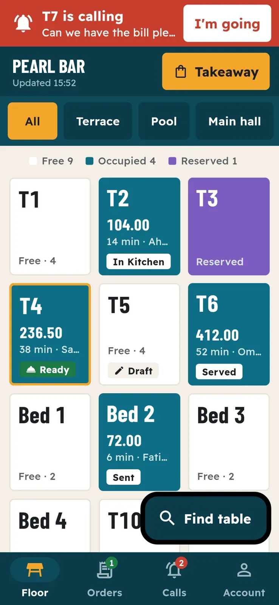
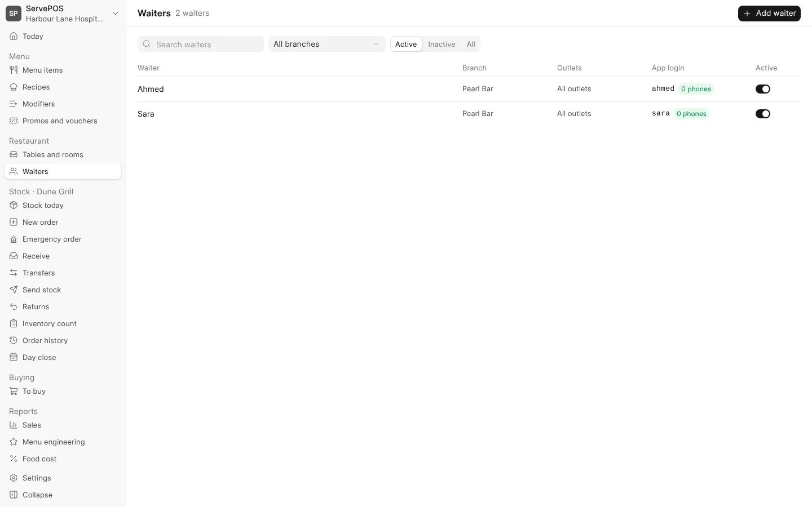
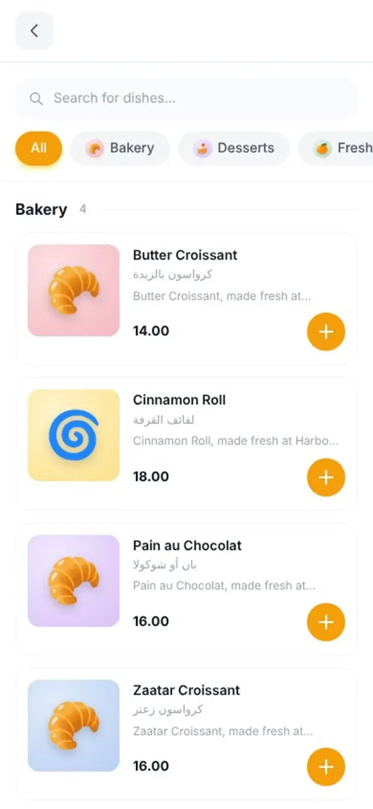

# Waiter app and guest QR

## The waiter app

Waiters take orders at the table on an Android phone or iPhone. Orders go to the POS and the kitchen, and guests' calls ring on the waiters' phones.

### 1. Add the waiter and their login

In the manager app, open **Waiters** › **Add waiter**:

| Field | What to enter |
|---|---|
| **Name** | The waiter's name |
| **Phone** | Optional |
| **POS PIN** | Optional: a PIN if they also use the desktop POS |
| **Branch** and **Outlets this waiter works at** | Their outlets, or **All outlets** |

Save. Open the waiter again and, under **Waiter app login**, click **Create login**. The manager app shows the **Server**, **Username** and **Password** to give the waiter. The password is shown only now; you can set a new one later with **New password**.

### 2. Install the app

Install the Serve POS waiter app from Google Play or the App Store (the links are on the Serve POS website once the apps are published). Developers can also build it from the [waiterapp repository](https://github.com/badeeltechnology/waiterapp).

### 3. Sign in

1. **Connect to your restaurant**: paste the server address the manager gave (your site, `https://your.site`) and tap **Continue**.
2. **Sign in** with the username and password.
3. Choose the outlet.

The waiter can then turn on **Fingerprint unlock**, so the next sign-in is a touch.

### 4. Take orders

On the **Floor**, tap a table, add items with their modifiers, and send. The order appears on the POS and prints in the kitchen. If **Auto-accept waiter orders** is off ([print format](print-format.md#print-document-settings)), the cashier accepts it first, in **Waiter app** at the top of the POS.

The cashier takes the payment at the POS as usual.

### Calls ring on the waiters' phones

When a guest taps **Call waiter**, every waiter at the outlet gets a notification. The first one to tap **I'm going** takes the call; the others see who took it.

For the phones to ring even when the app is closed, add a push notification key once:

1. In the [Firebase console](https://console.firebase.google.com), open your project (or create one) › **Project settings** › **Service accounts** › **Generate new private key**. A JSON file downloads.
2. In the manager app, open **Settings** › **Push notifications**, paste the contents of the file and click **Save key**.
3. Click **Send a test**.

## Guest QR menu

Each table gets a QR code. Guests scan it with their phone camera to see the menu with photos in English or Arabic, order, or call a waiter. There is no app to install.

### 1. Turn it on for the outlet

In ERPNext, open the outlet's **POS Profile** › **POS Configurations** › **Guest Calling & Branding**:

| Field | What it does |
|---|---|
| **Enable Guest Calling** | Turns on the QR menu and **Call waiter** for this outlet |
| **Online Order Waiter** | The waiter that guest orders are put under, for example a waiter called *Online* |
| **Online Order Start Time** and **End Time** | When guests can order. Leave both empty for all day. |
| **Restaurant Display Name**, **Description** and **Logo** | What guests see at the top |
| **Venue Name** and **Venue Logo** | For outlets inside a hotel or resort |
| **Menu Images** | Photos of your printed menu, which guests can swipe through |

### 2. Print the QR codes

In the manager app, open **Tables and rooms** › **Print QR codes**. Print the sheet and put each code on its table.

### 3. What happens to a guest order

The order lands on the POS like a waiter order and goes to the kitchen (after the cashier accepts it, if auto-accept is off). The guest sees its status on their phone. The cashier takes the payment at the end as usual.

**Next:** [Recipes and food cost](recipes.md)
